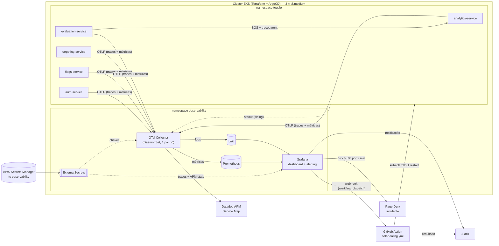

<div align="center">
  <br/>
  <hr style="border: none; border-top: 1px solid #ED145B; width: 100%; margin: 0 auto"/>
</div>


# Tech Challenge - Objetivos da Fase 4

Na Fase 3, eliminamos o trabalho manual: a infraestrutura passou a ser criada via **Terraform**, as imagens passaram por **pipelines de CI/DevSecOps** e o cluster passou a ser sincronizado via **GitOps com ArgoCD**. O ToggleMaster agora é atualizado várias vezes por dia sem ninguém rodar `kubectl apply`.

Mas entregar rápido não basta: é preciso **saber o que está acontecendo** com o sistema em produção. Na Fase 4, o objetivo é **Observabilidade Total e Resposta Ativa**: "se um serviço ficar lento, vemos o Trace; se der erro, temos os Logs centralizados; se um limite for atingido, o time é acordado; e o próprio sistema tenta se curar".

Instrumentamos os 5 microsserviços do ToggleMaster (`auth`, `flags`, `targeting`, `evaluation`, `analytics`) com **OpenTelemetry**, provisionamos uma stack de monitoramento open source (**Prometheus, Loki e Grafana**) via GitOps, integramos o **Datadog APM** para tracing distribuído e configuramos **alertas inteligentes** com abertura de incidente no **PagerDuty**, notificação via **Slack** (ChatOps) e **Self-Healing** automático por **GitHub Action**.

## Entregáveis da Fase 4

1. **Vídeo de Demonstração (até 25 minutos):** 🚧 [Vídeo de Demonstração Tech Challenge Fase 4](#) — roteiro em [`ROTEIRO-PROVA-REAL.md`](ROTEIRO-PROVA-REAL.md).

2. **Documentação Separada por Tópicos:**

- [O Problema: Falha Silenciosa](#o-problema-falha-silenciosa);
- [Pré-requisito: Base das Fases 1, 2 e 3](#pré-requisito-base-das-fases-1-2-e-3);
- [Como a stack entra no cluster (GitOps)](#como-a-stack-entra-no-cluster-gitops);
- [Monitoramento Open Source (Prometheus, Loki e Grafana)](#monitoramento-open-source-prometheus-loki-e-grafana);
- [OpenTelemetry Collector & Padronização](#opentelemetry-collector--padronização);
- [Instrumentação e APM](#instrumentação-e-apm);
- [Alertas Inteligentes, Incidentes e ChatOps](#alertas-inteligentes-incidentes-e-chatops);
- [Self-Healing](#self-healing);
- [Chaves externas: onde e como configurar](#chaves-externas-onde-e-como-configurar);
- [A Prova Real: Roteiro do Incidente](#a-prova-real-roteiro-do-incidente);
- [Justificativa Técnica](#justificativa-técnica);
- [Evidências Visuais](#evidências-visuais);
- [Dificuldades Encontradas](#dificuldades-encontradas);
- [Estimativa de Custos](#estimativa-de-custos);
- [Diagrama de Arquitetura](#diagrama-de-arquitetura);

3. **Código Fonte no Repositório:**

| O quê | Onde |
|---|---|
| Stack de observabilidade (GitOps) | [`fase-4/gitops/`](gitops/) — `applicationset.yaml`, `components.yaml`, `values/`, `manifests/observability/` |
| Variáveis OTel comuns aos 5 serviços | [`fase-3/components/otel/`](../fase-3/components/otel/) (Kustomize Component) |
| Instrumentação Python | `fase-2/{flags,targeting,analytics}-service/telemetry.py` + `gunicorn.conf.py` |
| Instrumentação Go | `fase-2/{auth,evaluation}-service/telemetry.go` (+ `sqs.go` no evaluation) |
| Alertas, contact points e policy | [`fase-4/gitops/manifests/observability/alerting.yaml`](gitops/manifests/observability/alerting.yaml) |
| Self-Healing | [`.github/workflows/self-healing.yml`](../.github/workflows/self-healing.yml) + runbook [`runbooks/5xx-alto.md`](runbooks/5xx-alto.md) |
| Injeção de falha (prova real) | `fase-2/auth-service/chaos.go` + [`scripts/`](scripts/) |

4. **Relatório de Entrega (.PDF):** 🚧 nomes, RMs, usernames, links do repositório e do vídeo, evidências visuais e justificativa técnica.

5. **Integrantes do Grupo**:

- [Aline Estevo da Silva](https://www.linkedin.com/in/aline-estevo)
- [Thiago de Melo Macedo](https://www.linkedin.com/in/thiago-melo-macedo)

> **Importante — Ambiente de Nuvem (AWS Academy):** assim como nas fases anteriores, trabalhamos sob as restrições do AWS Academy: **não é possível criar Roles ou Policies de IAM** e **não há IRSA**. Isso impacta diretamente a escolha da automação de Self-Healing (ver [Self-Healing](#self-healing)) e o envio de dados para serviços externos (Datadog, PagerDuty, Slack), cujas chaves são entregues aos pods pelo **External Secrets Operator** a partir do AWS Secrets Manager — nunca versionadas no Git.

## O Problema: Falha Silenciosa

No último final de semana, o `evaluation-service` começou a falhar **silenciosamente**:

- **Ninguém percebeu:** não havia alertas; a equipe levou **6 horas** para ser avisada — pelos usuários.
- **O autoscaling piorou a situação:** como o HPA escala por consumo de recursos, ele interpretou as falhas como "mais carga" e subiu réplicas, aumentando o custo sem resolver nada.
- **Investigação às cegas:** foram mais **4 horas** para achar a causa raiz, porque os logs estavam espalhados pelos pods (e somem quando o pod é recriado).
- **Nenhuma reação automática:** toda mitigação dependia de alguém acordar, entrar no cluster e agir manualmente.

> **Analogia:** é como ter um carro moderníssimo, que se monta sozinho em minutos (Terraform) e troca de peça sozinho na estrada (GitOps), mas **sem painel**: sem velocímetro, sem luz de óleo, sem alarme. O carro só para quando o motor já fundiu — e quem avisa é o passageiro.

O que construímos para cada ponto:

| Dor do fim de semana | Resposta da Fase 4 |
|---|---|
| 6 h sem ninguém saber | Alerta de **5xx > 5%** por serviço → incidente no PagerDuty + mensagem no Slack em ~2 min |
| HPA escalando por CPU | Métricas de **erro e latência** por serviço (o sintoma, não o recurso) |
| 4 h procurando a causa | **Logs centralizados no Loki** (com `trace_id`) + **trace distribuído no Datadog** |
| Mitigação manual | **Self-Healing**: GitHub Action reinicia o serviço afetado sozinha |

## Pré-requisito: Base das Fases 1, 2 e 3

A Fase 4 é construída **em cima** da arquitetura automatizada das fases anteriores, que continua em funcionamento:

| Requisito | Onde está |
|---|---|
| 5 microsserviços conteinerizados | [`fase-2/`](../fase-2/) (`<svc>-service/Dockerfile`) |
| Infraestrutura via Terraform | [`fase-3/infra/`](../fase-3/infra/) |
| CI/CD com DevSecOps | `.github/workflows/ci-<svc>.yml` + `_reusable-ci-service.yml` |
| Kubernetes (EKS) gerenciado via GitOps | [`fase-3/gitops/`](../fase-3/gitops/) (ArgoCD + ApplicationSet) |

## Como a stack entra no cluster (GitOps)

Nada da observabilidade é instalado à mão. Um **segundo ApplicationSet**, `observability` ([`gitops/applicationset.yaml`](gitops/applicationset.yaml)), lê a lista [`gitops/components.yaml`](gitops/components.yaml) e gera uma `Application` por item:

| Componente | Tipo | Versão |
|---|---|---|
| `observability` | manifests (Kustomize): senha do Grafana, ExternalSecrets, dashboard, alerting | — |
| `kube-prometheus-stack` | Helm (Prometheus + Grafana + kube-state-metrics + node-exporter) | chart 92.10.1 |
| `loki` | Helm (SingleBinary) | chart 7.3.0 |
| `otel-collector` | Helm (DaemonSet, imagem `contrib`) | chart 0.176.0 |

- **Helm multi-source:** o chart vem do repositório oficial e os `values` vêm deste Git (`$values/fase-4/gitops/values/<nome>.yaml`). Trocar a versão de um componente é mudar **uma linha** no `components.yaml`.
- **O ApplicationSet da Fase 3 não foi tocado:** mudar o nome de uma Application gerada cria um órfão, e o prune derruba o pod. A observabilidade ganhou o seu próprio ApplicationSet.
- **Terraform:** o `null_resource` que aplica o ApplicationSet raiz passou a aplicar uma **lista** (`gitops_root_app_paths`), e não um arquivo por componente.
- **Capacidade:** o node group do lab subiu de 2 para **3 × `t3.medium`** para caber a stack sem despejar os serviços.

> **Exemplo:** para adicionar um novo componente (ex.: Tempo), basta acrescentar um item ao `components.yaml` e um arquivo em `values/`. O ArgoCD cria a `Application` sozinho.

## Monitoramento Open Source (Prometheus, Loki e Grafana)

- **Prometheus** (v3): métricas de infraestrutura (`kube-state-metrics`, `node-exporter`) e métricas de aplicação, recebidas **via OTLP nativo** (`--web.enable-otlp-receiver`), sem exporter intermediário. Retenção de 2 dias em `emptyDir`, porque o lab é recriado a cada sessão.
- **Loki** (v3, SingleBinary): logs de **todos** os containers, recebidos via **OTLP nativo** (`/otlp`). Retenção de 48 h. Os logs deixam de "morrer junto com o pod".
- **Grafana** (v13): datasources Prometheus e Loki provisionados por código. A senha de admin é gerada **dentro do cluster** pelo ESO (gerador `Password`), uma única vez. O acesso é só por `port-forward`, sem nada exposto na internet. O Alertmanager do chart fica **desligado**, porque os alertas vivem no Grafana.

```bash
kubectl -n observability get secret grafana-admin -o jsonpath='{.data.admin-password}' | base64 -d; echo
kubectl -n observability port-forward svc/kube-prometheus-stack-grafana 3000:80   # http://localhost:3000 (admin)
```

### Dashboard customizado: "Saúde do Ecossistema ToggleMaster"

JSON versionado em [`manifests/observability/dashboards/`](gitops/manifests/observability/dashboards/), entregue como ConfigMap (label `grafana_dashboard: "1"`) e carregado pelo sidecar do Grafana (uid `togglemaster-saude`):

| Painel | Fonte | O que responde |
|---|---|---|
| CPU/memória do cluster e por serviço | Prometheus | "O cluster está no limite?" |
| Requisições por segundo por serviço | Prometheus (métricas OTel) | "Quem está recebendo tráfego?" |
| % de erros HTTP 5xx por serviço | Prometheus (métricas OTel) | "Quem está falhando?" |
| Latência p95 por serviço | Prometheus (métricas OTel) | "Quem está lento?" |
| Réplicas e restarts | Prometheus | "O HPA/KEDA está escalando? Tem pod reiniciando?" |
| Logs ao vivo | Loki | "O que os serviços estão dizendo agora?" |

> **Exemplo:** se o `evaluation-service` repetir a falha do fim de semana, o painel de **5xx** sobe, o de **réplicas** mostra o HPA escalando e, logo abaixo, o painel de **logs** mostra a mensagem de erro, tudo na mesma tela, em segundos e não em 10 horas.

## OpenTelemetry Collector & Padronização

O **OpenTelemetry Collector** é a peça central: os microsserviços **não falam diretamente** com Prometheus, Loki ou Datadog. Eles mandam tudo via **OTLP** para o Collector, que processa e roteia.

> **Analogia:** o Collector é uma **central dos Correios**. Cada serviço só precisa saber o endereço da central e deixar a carta (telemetria) lá. A central separa as cartas e entrega cada uma no destino certo: métricas no Prometheus, logs no Loki, traces no Datadog. Se amanhã trocarmos o APM, só a central muda e nenhum serviço é recompilado.

**Modo DaemonSet (1 Collector por nó):** cada serviço manda para o Collector **do próprio nó**, pelo endereço `http://$(HOST_IP):4318`, com `hostPort` e IP do nó via `status.hostIP`. O mesmo pod lê os logs de todos os containers do nó em `/var/log/pods`, substituindo o Promtail, que foi descontinuado.

| Etapa | Componentes | Função |
|---|---|---|
| **Receivers** | `otlp` (4317/4318), `filelog`, `prometheus` (auto-métricas) | Recebem telemetria dos serviços e os logs dos containers |
| **Processors** | `memory_limiter` → `k8sattributes` → `resource` → `batch` | Protegem a memória, anexam namespace/deployment/pod, carimbam `k8s.cluster.name` e `deployment.environment=lab` e agrupam envios |
| **Connectors** | `datadog/connector` | Calcula as estatísticas de APM (hits, erros, latência) a partir dos traces |
| **Exporters** | `otlphttp/prometheus`, `otlphttp/loki`, `datadog` | Entregam cada sinal ao seu backend |

| Pipeline | De | Para |
|---|---|---|
| `metrics` | SDKs OTel + auto-métricas | Prometheus |
| `logs` | `filelog` (stdout dos containers) + SDKs | Loki |
| `traces` | SDKs OTel | Datadog **e** `datadog/connector` |
| `metrics/datadog` | `datadog/connector` | Datadog (estatísticas de APM: Service Page e Service Map) |

**Padronização por configuração, não por código:** as variáveis `OTEL_*` são definidas **uma vez** no Kustomize Component [`fase-3/components/otel`](../fase-3/components/otel/kustomization.yaml), incluído pelas 5 overlays:

| Variável | Valor |
|---|---|
| `OTEL_SERVICE_NAME` | `<app>-service` (derivado do label `app` via `fieldRef`) |
| `OTEL_EXPORTER_OTLP_ENDPOINT` / `_PROTOCOL` | `http://$(HOST_IP):4318` / `http/protobuf` |
| `OTEL_RESOURCE_ATTRIBUTES` | `service.namespace=toggle-master,k8s.pod.ip=$(POD_IP)` |
| `OTEL_METRIC_EXPORT_INTERVAL` | `15000` (15 s) |
| `OTEL_SEMCONV_STABILITY_OPT_IN` | `http` (nomes estáveis: `http.server.request.duration`) |
| `OTEL_PYTHON_EXCLUDED_URLS` | `/health` (as probes não poluem a taxa de erro nem o APM) |

> *Nota:* o desafio permite usar o **Grafana Alloy** no lugar do OTel Collector. Ficamos com o **OTel Collector `contrib`**: é o padrão neutro da CNCF, tem exporter e connector oficiais do Datadog e não amarra a arquitetura ao ecossistema Grafana.

## Instrumentação e APM

### Instrumentação do código

| Serviço | Linguagem | O que gera spans/métricas |
|---|---|---|
| `auth-service` | Go | `otelhttp` (servidor) + `otelsql` (PostgreSQL) |
| `evaluation-service` | Go | `otelhttp` (servidor **e** cliente: chamadas a auth/flags/targeting) + `redisotel` (Redis) + span `PRODUCER` manual no `SendMessage` do SQS |
| `flags-service` | Python | Flask + psycopg2 + requests (chamada ao auth) |
| `targeting-service` | Python | Flask + psycopg2 + requests (chamada ao auth) |
| `analytics-service` | Python | botocore (SQS/DynamoDB) + span `CONSUMER` manual por mensagem |

- **Go** (`telemetry.go`, idêntico nos 2 serviços): SDK com exporters OTLP/HTTP de traces e métricas, propagador W3C e **desligamento gracioso** (`signal.NotifyContext`), que esvazia os buffers quando o Kubernetes manda `SIGTERM`.
- **Python** (`telemetry.py`, idêntico nos 3 serviços): o SDK é ligado no hook **`post_fork` do gunicorn**, uma vez por worker, e **não** pelo `opentelemetry-instrument`. As threads de exportação não sobrevivem ao `fork`, e cada worker precisa do próprio `service.instance.id`; sem isso, o Prometheus via o contador "voltar" e as taxas saíam erradas. Quem decide o que é instrumentado é o `requirements.txt` de cada serviço.
- **Logs com `trace_id`:** o `LoggingInstrumentor` (Python) coloca `trace_id`/`span_id` em cada linha. No Loki, dá para pular do log para o trace.
- **`/health` fora da instrumentação** nos 5 serviços: as probes rodam a cada poucos segundos e sempre respondem 200, o que diluiria a taxa de erro do alerta.

### Distributed Tracing

O contexto W3C (`traceparent`) é propagado em todas as chamadas HTTP pelos instrumentadores de cliente e servidor. No trecho **assíncrono** (evaluation → SQS → analytics), não existe instrumentação oficial para o `aws-sdk-go` v1. Por isso o `evaluation` injeta o `traceparent` nos **MessageAttributes** da mensagem, e o `analytics` o extrai antes de processá-la.

> **Exemplo:** uma chamada ao `evaluation-service` gera **um único trace** que mostra, em uma linha do tempo, a validação no `auth`, a busca da flag no `flags`, as regras no `targeting`, o Redis e o envio ao SQS, e continua no `analytics` quando ele consome a mensagem. Validado no lab: o mesmo `trace_id` aparece nos logs do `analytics` ("Processando mensagem") e do `flags`/`targeting`.

### Ferramenta APM e Service Map: Datadog

Os traces saem do Collector pelo exporter `datadog`, **sem instalar o Datadog Agent**. O `datadog/connector` calcula as estatísticas de APM e alimenta a **Service Page** e o **Service Map**, com os 5 serviços e suas dependências (PostgreSQL, Redis, SQS). O ambiente aparece como `env:lab`.

## Alertas Inteligentes, Incidentes e ChatOps

Tudo como código em [`manifests/observability/alerting.yaml`](gitops/manifests/observability/alerting.yaml). São ConfigMaps com o label `grafana_alert: "1"`, carregados pelo sidecar de alertas do Grafana, que os recarrega sem reiniciar o pod.

### O alerta

| Alerta | Condição | Por quê |
|---|---|---|
| **Taxa de erros 5xx acima de 5%** | `% de respostas 5xx > 5` **por serviço**, sustentado por **2 min**, avaliado a cada 30 s | Detecta a "falha silenciosa" mesmo com CPU/memória normais |

A query usa a métrica OTel `http_server_request_duration_seconds_count` e extrai o rótulo `service` (`auth`, `flags`, ...) do `job` (`toggle-master/<svc>-service`). Esse rótulo é o que o self-healing recebe.

**Combate à fadiga de alertas (*Alert Fatigue*):**

- **Sintoma, não causa:** 1 regra de taxa de erro cobre os 5 serviços, em vez de dezenas de alertas para causas possíveis.
- **Janela de 2 min:** um pico de segundos não acorda ninguém.
- **Guarda de tráfego:** só avalia serviços com mais de 0,1 req/s. "1 erro em 3 requisições" de madrugada não vira incidente.
- **Agrupamento por `alertname` + `service`:** 1 incidente por serviço afetado, e não 1 por pod. O `repeat_interval` de 4 h evita repetir a mesma notificação.
- **Sem dados = OK:** serviço sem 5xx não gera série, e isso não é tratado como problema.

> **Analogia:** um alarme de incêndio que toca a cada torrada queimada faz todo mundo parar de prestar atenção nele. Por isso o alarme só toca quando há fumaça de verdade por um tempo, e aí ele **sempre** merece atenção.

### Gerenciamento de incidentes: PagerDuty

O contact point `togglemaster-incidente` tem o receiver **PagerDuty** (Events API v2). O incidente **abre** quando o alerta entra em *Firing* e **fecha sozinho** quando ele volta a *Normal* (*Resolved*), com o serviço como `component`.

### Notificação (ChatOps): Slack

O mesmo contact point manda para o **Slack** (Incoming Webhook) uma mensagem com o estado (ALERTA/RESOLVIDO), o serviço, a % atual de 5xx, a descrição, o link do **runbook** ([`runbooks/5xx-alto.md`](runbooks/5xx-alto.md)) e o link do **dashboard**. A Action de self-healing **fecha o ciclo** no mesmo canal: "auth-service reiniciado e pronto".

## Self-Healing

```
alerta Firing ──webhook──> GitHub API (workflow_dispatch, ref=lab, inputs.service=auth)
                               └─> .github/workflows/self-healing.yml
                                     1. valida "auth" contra fase-3/services.yaml (allowlist)
                                     2. autentica na AWS (.github/actions/aws-auth, a mesma da Fase 3)
                                     3. cooldown: último restart há < 10 min? → pula e avisa que precisa de humano
                                     4. kubectl rollout restart deployment/auth-deployment + rollout status
                                     5. resumo no Step Summary + mensagem no Slack
```

**Decisões:**

- **GitHub Action, e não AWS Lambda:** no AWS Academy não dá para criar a Role da Lambda nem usar IRSA. O GitHub Actions já tem a autenticação AWS resolvida desde a Fase 3.
- **`workflow_dispatch`, e não `repository_dispatch`:** o `repository_dispatch` só executa workflows da **branch padrão** (`main`), e a Fase 4 roda na `lab`. Com `workflow_dispatch`, o Grafana escolhe a branch (`"ref": "lab"`) no corpo da chamada. O webhook do Grafana 13 monta esse corpo com *Custom Payload*, sem nenhum "tradutor" no meio.
- **Um único workflow parametrizado:** mantém a regra da Fase 3 de **não ter arquivo por serviço** em Actions. A lista de serviços válidos sai do `services.yaml`.
- **Segurança:** o nome do serviço vem de fora (webhook). Por isso ele só entra no script por variável de ambiente, é validado por regex e precisa existir no `services.yaml`; `auth; rm -rf /` é rejeitado. O token do Grafana é um *fine-grained PAT* restrito a este repositório, com a permissão *Actions: write* apenas.
- **Proteção contra loop:** `concurrency` por serviço (2 alertas seguidos não geram 2 restarts juntos) e **cooldown de 10 min**, lido do `kubectl.kubernetes.io/restartedAt` que o próprio `rollout restart` grava. Se o restart não curou, o problema não é de estado: o workflow não insiste e avisa no Slack que precisa de um humano, que já foi chamado pelo PagerDuty.
- **Disparo manual** para testes: `gh workflow run self-healing.yml --ref lab -f service=auth`.

## Chaves externas: onde e como configurar

As 5 chaves ficam em **um único secret** do **AWS Secrets Manager** (`us-east-1`), chamado **`tc-observability`**. O External Secrets Operator as entrega aos pods; nada vai para o Git.

| Chave | Onde obter | Quem usa |
|---|---|---|
| `DD_API_KEY` | Datadog → *Organization Settings* → *API Keys* | OTel Collector (`datadog-keys`) |
| `DD_SITE` | o domínio da sua conta Datadog: `datadoghq.com` (US1), `us5.datadoghq.com`, `datadoghq.eu`... | OTel Collector |
| `PAGERDUTY_ROUTING_KEY` | PagerDuty → *Services* → (serviço) → *Integrations* → *Events API V2* → *Integration Key* | Grafana (`grafana-alerting`) |
| `SLACK_WEBHOOK_URL` | Slack → *api.slack.com/apps* → (app) → *Incoming Webhooks* → *Add New Webhook* (escolha o canal) | Grafana e workflow de self-healing |
| `GITHUB_DISPATCH_TOKEN` | GitHub → *Settings* → *Developer settings* → *Fine-grained tokens*: só o repositório `fiap-tech-challenges`, permissão **Actions: Read and write** | Grafana (webhook do self-healing) |

Criação (as chaves são digitadas sem eco e não ficam no histórico do shell):

```bash
for k in DD_API_KEY DD_SITE PAGERDUTY_ROUTING_KEY SLACK_WEBHOOK_URL GITHUB_DISPATCH_TOKEN; do
  read -rsp "$k: " v; echo; export "$k=$v"
done
jq -n 'env | {DD_API_KEY, DD_SITE, PAGERDUTY_ROUTING_KEY, SLACK_WEBHOOK_URL, GITHUB_DISPATCH_TOKEN}' \
  | aws secretsmanager create-secret --region us-east-1 --name tc-observability --secret-string file:///dev/stdin
unset DD_API_KEY DD_SITE PAGERDUTY_ROUTING_KEY SLACK_WEBHOOK_URL GITHUB_DISPATCH_TOKEN
# para trocar valores depois: mesmo pipe com `aws secretsmanager put-secret-value --secret-id tc-observability`
```

**Ordem segura:** crie o secret **antes** de sincronizar as fatias 7, 9 e 10. Se ele for criado depois, force a leitura e reinicie quem lê as chaves como variável de ambiente (elas só são lidas na subida do pod):

```bash
kubectl -n observability annotate externalsecret datadog-keys grafana-alerting force-sync=$(date +%s) --overwrite
kubectl -n observability rollout restart deploy/kube-prometheus-stack-grafana daemonset/otel-collector-opentelemetry-collector-agent
```

> Sem o secret, **nada cai**: o Collector continua entregando métricas e logs ao Prometheus/Loki (só o Datadog fica sem dados), e o Grafana sobe normalmente (só os contact points ficam sem chave).

## A Prova Real: Roteiro do Incidente

Roteiro completo, com tempos e troubleshooting, em [`ROTEIRO-PROVA-REAL.md`](ROTEIRO-PROVA-REAL.md). Resumo:

1. **Visão geral:** cluster EKS (Terraform) e ArgoCD com as 11 Applications `Synced/Healthy`: as 7 da Fase 3 e as 4 da observabilidade.
2. **Métricas, logs e OTel:** dashboard no Grafana, busca no Loki por `trace_id` e o roteamento do Collector.
3. **APM:** Service Map no Datadog e o trace distribuído de uma chamada ao `evaluation`.
4. **Causar o problema:** `fase-4/scripts/prova-real.sh on` liga a injeção de falha no `auth-service` (estado **em memória**, que o restart realmente cura). O `/validate` passa a responder 500, enquanto o `/health` continua 200: é a falha silenciosa.
5. **Alerta:** *Pending* → *Firing* em ~2 min.
6. **Incidente e ChatOps:** incidente no PagerDuty e mensagem no Slack.
7. **Self-Healing:** GitHub Action executando; no terminal, `kubectl get pods -w` mostra o pod sendo trocado.
8. **Recuperação:** 5xx volta a 0, alerta *Resolved*, incidente fechado e mensagem "RESOLVIDO" no Slack.

## Justificativa Técnica

### Arquitetura do OTel

- **Padronização:** Go e Python falam o mesmo protocolo (OTLP) com as mesmas convenções semânticas (`http.server.request.duration`, `service.name`...). Um dashboard e um alerta servem para os 5 serviços.
- **Independência de fornecedor:** trocar o Datadog pelo New Relic é trocar um exporter no `values/otel-collector.yaml`, sem recompilar nenhum serviço.
- **Enriquecimento centralizado:** os metadados do Kubernetes (namespace, deployment, pod, nó) são anexados em um único lugar, o `k8sattributes`.
- **Backends nativos em OTLP:** Prometheus 3 e Loki 3 recebem OTLP direto, sem exporters legados (Promtail, `prometheusremotewrite`).

### Datadog vs New Relic

| Critério | Datadog | New Relic |
|---|---|---|
| Entrada OTel | exporter + connector oficiais no Collector `contrib` (sem Agent) | endpoint OTLP nativo |
| Acesso para estudante | Datadog Pro pelo *GitHub Student Developer Pack* (ou trial) | plano gratuito permanente com cota mensal de ingestão |
| Service Map / trace distribuído | sim | sim |
| Correlação log ↔ trace | sim (`trace_id`) | sim (`trace_id`) |
| Adoção no mercado (vagas DevOps/SRE no Brasil) | muito alta | alta |

**Escolha: Datadog.** Os dois atendem ao desafio. Pesou a favor do Datadog a integração **oficial** com o OTel Collector, que já era a peça central: o connector calcula as estatísticas de APM no próprio Collector, sem instalar o Datadog Agent em cada nó (o que, no lab de 3 nós, também economiza pods). Pesaram ainda o acesso via Student Pack e a adoção no mercado. A arquitetura não fica presa: trocar de fornecedor é mudar o exporter.

### OpsGenie vs PagerDuty

| Critério | PagerDuty | OpsGenie |
|---|---|---|
| Integração com Grafana | contact point nativo (Events API v2) | contact point nativo |
| Plano gratuito | sim (equipe pequena) | sim |
| Abre e fecha o incidente sozinho | sim (`trigger`/`resolve` pelo mesmo `dedup_key`) | sim |
| Futuro do produto | produto principal da empresa | a Atlassian anunciou o fim das vendas do OpsGenie, com migração para o Jira Service Management/Compass |

**Escolha: PagerDuty.** O OpsGenie está em descontinuação, e começar um projeto novo nele seria contratar uma migração. O PagerDuty é a referência de mercado em *on-call*, tem plano gratuito suficiente para o grupo e o contact point nativo do Grafana resolve abertura **e** fechamento do incidente sem código.

## Evidências Visuais

🚧 _Prints a adicionar após a gravação (salvar em `/.github/`):_

- Print 1: dashboard "Saúde do Ecossistema ToggleMaster" no Grafana.
- Print 2: trace distribuído no Datadog (evaluation → auth/flags/targeting → Redis → SQS → analytics) e Service Map.
- Print 3: incidente no PagerDuty e notificação no Slack.
- Print 4: execução do workflow `self-healing` (Step Summary) e o pod reiniciado.

## Dificuldades Encontradas

| Dificuldade | Causa | Solução |
|---|---|---|
| Application `observability` em *Unknown* | o *git files generator* do ApplicationSet injeta uma chave `path` que **sobrescrevia** a nossa chave `path` | renomeada para `sourcePath`; o teste local passou a simular o `path` injetado |
| Loki não subia | `readOnlyRootFilesystem` sem área de escrita em `/var/loki` | `emptyDir` montado em `/var/loki` |
| Métricas Python com taxa "maluca" | SDK ligado antes do `fork` do gunicorn: threads mortas nos workers e workers exportando a mesma série | SDK ligado no `post_fork`, com `service.instance.id` por worker |
| psycopg2 sem spans | `cursor_factory` passado por chamada anulava a instrumentação | `RealDictCursor` movido para o pool de conexões |
| `analytics` em CrashLoop | o instrumentor do `requests` era ligado porque a **biblioteca** existia, mas o **pacote de instrumentação** não estava instalado | detecção pelo pacote de instrumentação, e não pela biblioteca alvo |
| OTel Go v1.47 não compilava | exige Go 1.26; as imagens usam Go 1.25 | fixado em v1.46 |
| Trace quebrava no SQS | `aws-sdk-go` v1 sem instrumentação oficial | `traceparent` injetado e extraído nos `MessageAttributes` (span PRODUCER/CONSUMER) |
| Jobs de migração com imagem antiga após o merge | **corrida CI × ArgoCD**: o merge muda os manifests antes de o CI fazer o bump da tag, e o ArgoCD sincroniza no meio | *terminate* do sync + novo sync após o bump; documentado como ponto de atenção |
| Self-healing nunca disparava (no papel) | `repository_dispatch` só roda workflows da branch padrão (`main`) | Grafana chama `workflow_dispatch` com `"ref": "lab"` |
| `$` sumindo da configuração do Grafana | o Grafana expande `$VAR` nos arquivos de provisionamento, mas **não** no `model` da query | chaves como `${VAR}`; templates sem `$`; PromQL com `$1` (testado no Grafana 13.2.4 local) |
| Uma chave faltando derrubaria a observabilidade | `secretKeyRef` obrigatório no Collector | chave opcional + valor padrão: sem chave, só o Datadog fica sem dados |
| Cluster sem espaço para a stack | 2 × `t3.medium` já perto do limite de pods/memória | 3 nós, requests/limits enxutos, Alertmanager desligado, retenção curta |
| Sessões do AWS Academy | credenciais expiram a cada sessão; ECR vazio ao recriar o ambiente | trocar os 3 secrets AWS do GitHub **juntos**; exportar as variáveis `AWS_*` antes do `terraform apply`; rebuild/push das imagens |

## Estimativa de Custos

Valores de referência da AWS em `us-east-1` (sob demanda, ~730 h/mês). No AWS Academy, o custo sai dos créditos do lab.

| Item | Fase 3 | Fase 4 | Observação |
|---|---|---|---|
| Nós EKS (`t3.medium`, ~US$ 0,0416/h) | 2 × ≈ US$ 30 | 3 × ≈ US$ 30 | **+≈ US$ 30/mês**: o único custo AWS novo da observabilidade |
| Armazenamento de métricas/logs | — | US$ 0 | `emptyDir` no disco dos nós (sem EBS); retenção de 2 d (Prometheus) e 48 h (Loki) |
| Datadog APM | — | US$ 0 no Student Pack / trial | em conta paga, cobrado por host com APM, o maior custo da stack em produção |
| PagerDuty / Slack | — | US$ 0 | planos gratuitos |
| GitHub Actions (self-healing) | — | ≈ US$ 0 | ~1 min por execução, dentro da cota gratuita |

O restante (EKS control plane, RDS, ElastiCache, SQS, DynamoDB, NAT/ELB) segue a estimativa da Fase 3. **Em produção**, o caminho para baixar custo seria: amostragem de traces no Collector (ex.: `tail_sampling` mantendo 100% dos erros e uma fração do sucesso) e Prometheus/Loki em volume persistente com retenção definida pelo time.

## Diagrama de Arquitetura


