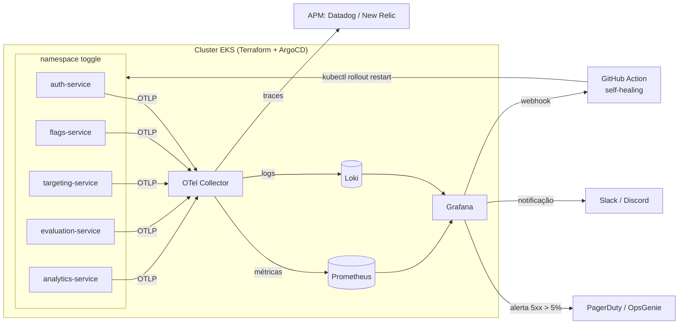

   
  

# Tech Challenge - Objetivos da Fase 4

Na Fase 3, eliminamos o trabalho manual: a infraestrutura passou a ser criada via **Terraform**, as imagens passaram por **pipelines de CI/DevSecOps** e o cluster passou a ser sincronizado via **GitOps com ArgoCD**. O ToggleMaster agora é atualizado várias vezes por dia sem ninguém rodar `kubectl apply`.

Mas entregar rápido não basta: é preciso **saber o que está acontecendo** com o sistema em produção. Na Fase 4, o objetivo é **Observabilidade Total e Resposta Ativa**: "se um serviço ficar lento, vemos o Trace; se der erro, temos os Logs centralizados; se um limite for atingido, o time é acordado; e o próprio sistema tenta se curar".

Instrumentamos os 5 microsserviços do ToggleMaster (`auth`, `flags`, `targeting`, `evaluation`, `analytics`) com **OpenTelemetry**, provisionamos uma stack de monitoramento open source (**Prometheus, Loki e Grafana**) via GitOps, integramos uma ferramenta de **APM** para tracing distribuído e configuramos **alertas inteligentes** com abertura de incidente, notificação via **ChatOps** e **Self-Healing** automático.

> 🚧 **Documento em evolução:** os trechos marcados com 🚧 serão preenchidos com as decisões finais e evidências à medida que a implementação for concluída.

## Entregáveis da Fase 4

1. **Vídeo de Demonstração (até 25 minutos):** 🚧 [Vídeo de Demonstração Tech Challenge Fase 4](#)

2. **Documentação Separada por Tópicos:**

- [O Problema: Falha Silenciosa](#o-problema-falha-silenciosa);
- [Pré-requisito: Base das Fases 1, 2 e 3](#pré-requisito-base-das-fases-1-2-e-3);
- [Monitoramento Open Source (Prometheus, Loki e Grafana)](#monitoramento-open-source-prometheus-loki-e-grafana);
- [OpenTelemetry Collector & Padronização](#opentelemetry-collector--padronização);
- [Instrumentação e APM](#instrumentação-e-apm);
- [Alertas Inteligentes, Incidentes e ChatOps](#alertas-inteligentes-incidentes-e-chatops);
- [Self-Healing](#self-healing);
- [A Prova Real: Roteiro do Incidente](#a-prova-real-roteiro-do-incidente);
- [Justificativa Técnica](#justificativa-técnica);
- [Evidências Visuais](#evidências-visuais);
- [Dificuldades Encontradas](#dificuldades-encontradas);
- [Estimativa de Custos](#estimativa-de-custos);
- [Diagrama de Arquitetura](#diagrama-de-arquitetura);

3. **Código Fonte no Repositório:**

- Código IaC/GitOps atualizado com a stack de monitoramento e o OTel Collector.
- Código fonte (ou Dockerfile) dos 5 microsserviços atualizado com a instrumentação OpenTelemetry.
- Scripts/automações do Self-Healing.

4. **Relatório de Entrega (.PDF):** 🚧 nomes, RMs, usernames, links do repositório e do vídeo, evidências visuais e justificativa técnica.

5. **Integrantes do Grupo**:

- [Aline Estevo da Silva](https://www.linkedin.com/in/aline-estevo)
- [Thiago de Melo Macedo](https://www.linkedin.com/in/thiago-melo-macedo)

> **Importante — Ambiente de Nuvem (AWS Academy):** assim como nas fases anteriores, trabalhamos sob as restrições do AWS Academy: **não é possível criar Roles ou Policies de IAM** e **não há IRSA**. Isso impacta diretamente a escolha da automação de Self-Healing (ver [Self-Healing](#self-healing)) e o envio de dados para serviços externos (APM, PagerDuty/OpsGenie), cujas chaves de API são entregues aos pods pelo **External Secrets Operator** a partir do AWS Secrets Manager — nunca versionadas no Git.

## O Problema: Falha Silenciosa

No último final de semana, o `evaluation-service` começou a falhar **silenciosamente**:

- **Ninguém percebeu:** não havia alertas; a equipe levou **6 horas** para ser avisada — pelos usuários.
- **O autoscaling piorou a situação:** como o HPA escala por consumo de recursos, ele interpretou as falhas como "mais carga" e subiu réplicas, aumentando o custo sem resolver nada.
- **Investigação às cegas:** foram mais **4 horas** para achar a causa raiz, porque os logs estavam espalhados pelos pods (e somem quando o pod é recriado).
- **Nenhuma reação automática:** toda mitigação dependia de alguém acordar, entrar no cluster e agir manualmente.

> **Analogia:** é como ter um carro moderníssimo, que se monta sozinho em minutos (Terraform) e troca de peça sozinho na estrada (GitOps), mas **sem painel**: sem velocímetro, sem luz de óleo, sem alarme. O carro só para quando o motor já fundiu — e quem avisa é o passageiro.

A resposta a esses pontos é, respectivamente: **alertas inteligentes** (com incidente no PagerDuty/OpsGenie e notificação no chat), **métricas de erro/latência** (e não só CPU/memória), **logs centralizados + traces distribuídos**, e **Self-Healing**.

## Pré-requisito: Base das Fases 1, 2 e 3

A Fase 4 é construída **em cima** da arquitetura automatizada das fases anteriores, que continua em funcionamento:

| Requisito | Onde está |
|---|---|
| 5 microsserviços conteinerizados | [`fase-2/`](../fase-2/) (`<svc>-service/Dockerfile`) |
| Infraestrutura via Terraform | [`fase-3/infra/`](../fase-3/infra/) |
| CI/CD com DevSecOps | `.github/workflows/ci-<svc>.yml` + `_reusable-ci-service.yml` |
| Kubernetes (EKS) gerenciado via GitOps | [`fase-3/gitops/`](../fase-3/gitops/) (ArgoCD + ApplicationSet) |

A stack de observabilidade segue as mesmas regras da Fase 3: **nada é instalado manualmente**. Ela entra no repositório GitOps e o ArgoCD a sincroniza. Como o ApplicationSet usa um *git directory generator* sobre `gitops/manifests/*`, basta criar a pasta da nova stack para que a `Application` correspondente seja gerada automaticamente — sem criar arquivo de `Application` por componente.

## Monitoramento Open Source (Prometheus, Loki e Grafana)

Os Helm charts das ferramentas base são adicionados ao repositório GitOps e sincronizados pelo ArgoCD no namespace de observabilidade:

- **Prometheus:** armazenamento e consulta das métricas de infraestrutura (nós, pods, containers via `kube-state-metrics`/`node-exporter`) e das métricas de aplicação recebidas do OTel Collector (taxa de requisições, erros, latência).
- **Loki:** centralização e indexação dos logs de **todos** os containers do cluster. Os logs deixam de "morrer junto com o pod" e passam a ser pesquisáveis por serviço, namespace, pod e nível.
- **Grafana:** ferramenta principal de visualização, com Prometheus e Loki já configurados como *datasources* via código.

### Dashboard customizado: "Saúde do Ecossistema ToggleMaster"

Dashboard versionado como código (JSON provisionado no Grafana), centralizando em uma única tela:

| Painel | Fonte | O que responde |
|---|---|---|
| Uso de CPU/memória do cluster e por serviço | Prometheus | "O cluster está no limite?" |
| Taxa de requisições por microsserviço (RPS) | Prometheus (métricas OTel) | "Quem está recebendo tráfego?" |
| Taxa de erros HTTP 5xx por microsserviço | Prometheus (métricas OTel) | "Quem está falhando?" |
| Latência p95/p99 por microsserviço | Prometheus (métricas OTel) | "Quem está lento?" |
| Réplicas, restarts e status dos pods | Prometheus | "O HPA/KEDA está escalando? Tem pod reiniciando?" |
| Painel de logs em tempo real | Loki | "O que os serviços estão dizendo agora?" |

> **Exemplo:** se o `evaluation-service` repetir a falha do fim de semana, o painel de **5xx** sobe, o de **réplicas** mostra o HPA escalando e, logo abaixo, o painel de **logs** mostra a mensagem de erro — tudo na mesma tela, em segundos, e não em 10 horas.

## OpenTelemetry Collector & Padronização

O **OpenTelemetry Collector** é a peça central da arquitetura: os microsserviços **não falam diretamente** com Prometheus, Loki ou APM. Eles enviam toda a telemetria (métricas, logs e traces) via protocolo **OTLP** para o Collector, que se encarrega de processar e rotear para o backend correto.

> **Analogia:** o Collector é como uma **central dos Correios**. Cada serviço só precisa saber o endereço da central e colocar a carta (telemetria) lá. A central separa as cartas e entrega cada uma no destino certo: métricas no Prometheus, logs no Loki, traces no APM. Se amanhã trocarmos o APM, só a central muda — nenhum serviço precisa ser alterado.

Pipeline do Collector:

| Etapa | Componentes | Função |
|---|---|---|
| **Receivers** | `otlp` (gRPC `4317` / HTTP `4318`), `filelog` (logs dos containers) | Recebem a telemetria dos serviços e os logs gravados pelos pods no nó |
| **Processors** | `memory_limiter`, `k8sattributes`, `resource`, `batch` | Protegem o Collector contra estouro de memória, enriquecem os dados com metadados do Kubernetes (namespace, pod, deployment) e agrupam envios |
| **Exporters** | Prometheus, Loki (OTLP), APM (Datadog **ou** New Relic) | Entregam cada sinal ao seu backend |

| Sinal | Origem | Destino |
|---|---|---|
| Métricas | SDK OTel dos serviços + métricas do cluster | Prometheus → Grafana |
| Logs | SDK OTel + `filelog` dos containers | Loki → Grafana |
| Traces | SDK OTel dos serviços | APM (Service Map + Trace distribuído) |

Os serviços apontam para o Collector apenas por **variáveis de ambiente padronizadas** (`OTEL_EXPORTER_OTLP_ENDPOINT`, `OTEL_SERVICE_NAME`, `OTEL_RESOURCE_ATTRIBUTES`), mantendo a regra das fases anteriores: a diferença entre ambientes é **configuração**, não código.

> *Nota:* o desafio permite usar o **Grafana Alloy** no lugar do OTel Collector padrão. 🚧 Escolha do grupo: _a preencher_.

## Instrumentação e APM

### Instrumentação do código

Cada microsserviço recebe as bibliotecas oficiais do OpenTelemetry da sua linguagem:

| Serviço | Linguagem | Estratégia de instrumentação |
|---|---|---|
| `auth-service` | Go | SDK OTel + `otelhttp` no servidor HTTP + instrumentação do driver Postgres |
| `evaluation-service` | Go | SDK OTel + `otelhttp` (servidor **e** cliente HTTP) + instrumentação de Redis e SQS |
| `flags-service` | Python | `opentelemetry-distro` + `opentelemetry-instrument` no Dockerfile (Flask, psycopg/SQLAlchemy) |
| `targeting-service` | Python | `opentelemetry-distro` + `opentelemetry-instrument` no Dockerfile (Flask, psycopg/SQLAlchemy) |
| `analytics-service` | Python | `opentelemetry-distro` + `opentelemetry-instrument` no Dockerfile (boto3/SQS, DynamoDB) |

- **Go:** como não há auto-instrumentação "mágica", o SDK é inicializado no `main.go` e os handlers/clientes são envolvidos pelos wrappers do OTel.
- **Python:** a instrumentação é feita **sem alterar a lógica de negócio** — o processo é iniciado pelo `opentelemetry-instrument`, que intercepta Flask, drivers de banco e boto3 automaticamente.

### Distributed Tracing

O contexto do trace (cabeçalho W3C `traceparent`) é propagado entre os serviços, permitindo que uma única requisição seja seguida de ponta a ponta:

> **Exemplo:** uma chamada ao `evaluation-service` gera um trace que mostra, em uma linha do tempo, a validação no `auth-service`, a busca da flag no `flags-service`, as regras no `targeting-service`, a consulta ao Redis e o envio do evento para o SQS, consumido depois pelo `analytics-service`. Se a resposta demorou 2 segundos, o trace mostra **exatamente qual etapa** gastou esse tempo.

Para o trecho assíncrono (SQS → `analytics-service`), o contexto é carregado nos *message attributes* da mensagem, mantendo o elo do trace mesmo sem uma chamada HTTP direta.

### Ferramenta APM e Service Map

🚧 Ferramenta escolhida: **Datadog** _ou_ **New Relic** (conta gratuita *for education*) — ver [Justificativa Técnica](#justificativa-técnica).

Os traces chegam ao APM pelo exporter do OTel Collector, e o painel exibe o **Service Map** com as dependências entre os 5 microsserviços e seus recursos (PostgreSQL, Redis, SQS, DynamoDB).

## Alertas Inteligentes, Incidentes e ChatOps

### Criação do alerta

Alertas definidos como código, focados em **sintomas que o usuário sente** (erro e lentidão), e não apenas em consumo de recursos — exatamente o que faltou no incidente do fim de semana:

| Alerta | Condição | Por quê |
|---|---|---|
| Taxa de erros 5xx alta | `5xx / total > 5%` por 5 minutos, por serviço | Detecta a "falha silenciosa" mesmo que CPU/memória pareçam normais |
| 🚧 Latência alta | p95 acima do limite definido por 5 minutos | Detecta lentidão antes de virar indisponibilidade |

**Combate à fadiga de alertas (*Alert Fatigue*):**

- Janela de avaliação (`for: 5m`) para não disparar por um pico de segundos.
- Alertas por **sintoma** e não por cada causa possível, evitando dezenas de alertas para um mesmo problema.
- Agrupamento por serviço e severidade, para que um incidente gere **uma** notificação, e não uma por pod.

> **Analogia:** um alarme de incêndio que toca a cada torrada queimada faz todo mundo parar de prestar atenção nele. Por isso o alarme só toca quando há fumaça de verdade por um tempo — e aí ele **sempre** merece atenção.

### Gerenciamento de incidentes

🚧 Ferramenta escolhida: **PagerDuty** _ou_ **OpsGenie** — integrada ao alerta para **abrir um incidente automaticamente** quando ele entra em estado *Firing*, e resolvê-lo quando o alerta volta ao normal.

### Notificação (ChatOps)

🚧 Canal escolhido: **Slack** _ou_ **Discord**. A notificação é detalhada, contendo: serviço afetado, valor atual da métrica, limite configurado, horário, link para o dashboard no Grafana e link para o runbook.

## Self-Healing

Quando o alerta dispara, uma automação reage **sem intervenção humana**, executando a ação corretiva no serviço afetado (ex.: `kubectl rollout restart deployment/<svc>`).

Fluxo proposto:

1. O alerta entra em *Firing* no Grafana.
2. Além do PagerDuty/OpsGenie e do chat, o alerta chama um **webhook**.
3. O webhook dispara um **GitHub Action** (via `repository_dispatch`) com o nome do serviço afetado no payload.
4. O workflow autentica na AWS (mesma composite action `.github/actions/aws-auth` da Fase 3), configura o `kubeconfig` do EKS e executa `kubectl rollout restart` no deployment do serviço informado.
5. O workflow aguarda o `rollout status` e registra o resultado (log da execução + mensagem no chat).

**Decisões:**

- **Um único workflow parametrizado**, que recebe o serviço no payload — mantendo a regra da Fase 3 de **não criar arquivo por serviço** em Actions.
- **Lista de serviços permitidos:** o workflow só reinicia deployments conhecidos (os do `services.yaml`), para que um payload malformado não reinicie algo indevido.
- **Por que GitHub Action e não AWS Lambda:** no AWS Academy não é possível criar uma Role própria para a Lambda nem usar IRSA; o GitHub Actions já possui a autenticação com a AWS resolvida desde a Fase 3.
- 🚧 **Proteção contra loop de reinício:** limite de execuções por janela de tempo (ex.: no máximo 1 restart a cada 10 minutos por serviço), para que um problema que o restart não resolve não vire uma sequência infinita de reinícios.

## A Prova Real: Roteiro do Incidente

Roteiro usado no vídeo para demonstrar o ciclo completo funcionando na prática:

1. **Visão geral:** mostrar o cluster EKS (Terraform) e o ArgoCD com todas as `Application`, incluindo a nova stack de observabilidade, em `Synced/Healthy`.
2. **Métricas, logs e OTel:** abrir o dashboard customizado no Grafana, buscar logs no Loki e explicar o roteamento feito pelo OTel Collector.
3. **APM e tracing:** abrir o Service Map, fazer uma requisição de teste no `evaluation-service` e exibir o trace distribuído.
4. **Causar o problema:** 🚧 _a definir_ (ex.: parar o banco do `flags-service` ou injetar erro proposital no código).
5. **Alerta:** mostrar o alerta passando para *Firing* no Grafana/APM.
6. **Incidente e ChatOps:** mostrar o incidente aberto no PagerDuty/OpsGenie e a notificação chegando no Slack/Discord.
7. **Self-Healing:** mostrar o GitHub Action sendo disparado e, no terminal, o pod sendo reiniciado (`kubectl get pods -w`).
8. **Recuperação:** mostrar a taxa de erros voltando ao normal, o alerta resolvido e o incidente fechado.

## Justificativa Técnica

### Arquitetura do OTel

O OTel Collector desacopla **quem produz** telemetria (os 5 microsserviços) de **quem armazena** (Prometheus, Loki, APM). Isso traz:

- **Padronização:** todos os serviços, em Go ou Python, falam o mesmo protocolo (OTLP) com as mesmas convenções de nomes.
- **Independência de fornecedor:** trocar Datadog por New Relic (ou adicionar um terceiro backend) é uma mudança de configuração no Collector, sem recompilar nenhum serviço.
- **Enriquecimento centralizado:** metadados do Kubernetes são adicionados em um único lugar, e não em cada aplicação.

### Datadog vs New Relic

| Critério | Datadog | New Relic |
|---|---|---|
| Recepção de OTLP | Via exporter/agente Datadog | Endpoint OTLP nativo |
| Plano educacional/gratuito | 🚧 | 🚧 |
| Service Map | Sim | Sim |
| Curva de aprendizado | 🚧 | 🚧 |

🚧 **Escolha do grupo e motivo:** _a preencher_.

### OpsGenie vs PagerDuty

| Critério | PagerDuty | OpsGenie |
|---|---|---|
| Integração com Grafana | Contact point nativo | Contact point nativo |
| Plano gratuito | 🚧 | 🚧 |
| Integração com Slack/Discord | 🚧 | 🚧 |

🚧 **Escolha do grupo e motivo:** _a preencher_.

## Evidências Visuais

🚧 _A preencher após a execução:_

- Print do Dashboard do Grafana.
- Print de um Trace distribuído no APM.
- Print da notificação de incidente no ChatOps.
- Print do log/execução da automação de Self-Healing.

## Dificuldades Encontradas

🚧 _A preencher ao longo da implementação._

Pontos de atenção já conhecidos a partir da Fase 3:

- **Capacidade do cluster de lab:** os 2 nós `t3.medium` suportam ~34 pods e já estavam próximos do limite com os 5 serviços. A stack de observabilidade (Prometheus, Loki, Grafana, Collector, exporters) adiciona vários pods e consumo de memória, exigindo ajuste de *requests/limits*, retenção curta de dados e/ou nós maiores.
- **Ausência de IRSA:** como na Fase 3, credenciais para serviços externos e AWS precisam vir de `Secret`s gerenciados pelo ESO.
- **Sessões do AWS Academy:** o ambiente é destruído e recriado entre sessões; a stack inteira precisa subir sozinha via GitOps, sem passos manuais.

## Estimativa de Custos

🚧 _A preencher_ — impacto da stack de observabilidade (armazenamento de métricas/logs, aumento de nós) somado à estimativa da Fase 3.

## Diagrama de Arquitetura

🚧 _Diagrama final em imagem a ser adicionado em `/.github/`._
